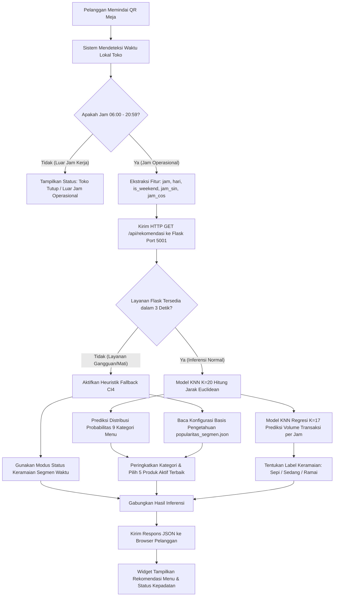

# ALUR INFERENSI SISTEM CERDAS

**Mata Kuliah**: Kecerdasan Buatan (Artificial Intelligence)  
**Diagram & Model**: Siklus Inferensi Waktu Riil, Percabangan Fallback, & Contoh Numerik  

---

## 1. Diagram Alur Inferensi Sistem (Mermaid Workflow)

Alur komputasi dari saat pelanggan membuka web pemesanan meja hingga rekomendasi tertampil digambarkan dalam diagram alir berikut:

---

## 2. Rincian Langkah Komputasi Inferensi

1. **Langkah 1: Deteksi & Ekstraksi Fitur Lingkungan**:
   - Sistem membaca jam dan tanggal dari server CodeIgniter (`Asia/Jakarta`).
   - Ekstraksi parameter: `jam = H`, `hari_minggu = D` ($0 \dots 6$), `is_weekend = (D \ge 5 ? 1 : 0)$, $\text{jam\_sin} = \sin(2\pi H/24)$, $\text{jam\_cos} = \cos(2\pi H/24)$.
2. **Langkah 2: Pemanggilan Layanan Inferensi**:
   - CI4 melakukan koneksi HTTP non-blocking ke `http://127.0.0.1:5001/api/rekomendasi`.
3. **Langkah 3: Transformasi Fitur & Pencarian Tetangga (KNN)**:
   - Fitur dinormalisasi dengan parameter rata-rata ($\mu$) dan simpangan baku ($\sigma$) latih.
   - Algoritma pencarian KD-Tree menemukan 20 tetangga terdekat dalam data 47.782 transaksi Lower Manhattan.
4. **Langkah 4: Pemeringkatan Produk & Pengecekan Ketersediaan**:
   - Probabilitas kategori dihitung dari proporsi 20 tetangga.
   - Kategori teratas diambil dan dicocokkan dengan katalog produk aktif di database.
   - Menu dengan stok kosong atau status tidak aktif secara otomatis digantikan oleh menu berikutnya.
5. **Langkah 5: Klasifikasi Kepadatan Antrean**:
   - Estimasi volume jam dibandingkan dengan batas kuantil ($\le 11$ Sepi, $11-28$ Sedang, $>28$ Ramai).
6. **Langkah 6: Penyajian UI Pelanggan**:
   - Kontroler CI4 mengirimkan payload terformat ke berkas view `app/Views/customer/order.php` untuk di-render menjadi elemen kartu menu.

---

## 3. Contoh Numerik Terverifikasi (Kasus: Senin Pukul 08:30 WIB)

Berikut adalah kalkulasi kasus nyata untuk kunjungan hari **Senin pukul 08:30 WIB**:

1. **Vektor Input Mentah**:
   - `jam` = 8, `menit` = 30, `hari_minggu` = 0 (Senin), `is_weekend` = 0.
   - `jam_sin` = $\sin(2\pi \cdot 8 / 24) = \sin(2.0944) = +0.8660$.
   - `jam_cos` = $\cos(2\pi \cdot 8 / 24) = \cos(2.0944) = -0.5000$.
2. **Hasil Inferensi Model KNN ($K=20$)**:
   - Dari 20 transaksi terdekat historis jam 08:00–09:00:
     - 10 transaksi membeli `Coffee` ($P = 0,50$).
     - 5 transaksi membeli `Bakery` ($P = 0,25$).
     - 3 transaksi membeli `Tea` ($P = 0,15$).
     - 2 transaksi membeli `Drinking Chocolate` ($P = 0,10$).
   - Peringkat Kategori: Peringkat 1 = **Coffee**, Peringkat 2 = **Bakery**, Peringkat 3 = **Tea**.
3. **Hasil Inferensi Model Regresi ($K=17$)**:
   - Rata-rata transaksi 17 tetangga terdekat pada jam 08:00 hari kerja = **34,5 transaksi/jam**.
   - Karena $34,5 > 28,0$, sistem menetapkan:
     - Status: **Ramai** (ikon: 🔴 Jam Sibuk Pagi).
4. **Keluaran Menu Terpilih pada UI**:
   - Menu 1: *Gourmet Brewed Coffee - Ethiopian Rg* (Kategori Coffee).
   - Menu 2: *Jumbo Chocolate Chip Cookie* (Kategori Bakery).
   - Menu 3: *Almond Croissant* (Kategori Bakery).
   - Menu 4: *Earl Grey Tea Rg* (Kategori Tea).
   - Menu 5: *Hot Chocolate Lg* (Kategori Drinking Chocolate).
