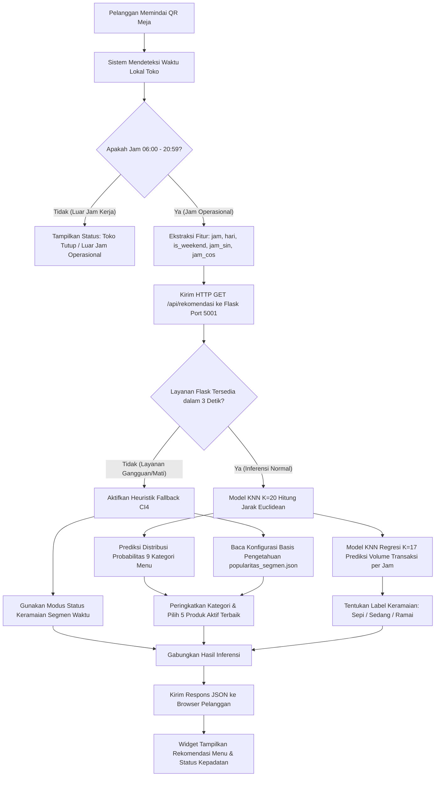

# LAPORAN LENGKAP PRAKTIKUM KECERDASAN BUATAN
## SISTEM REKOMENDASI MENU COFFEE SHOP BERBASIS WAKTU MENGGUNAKAN PENDEKATAN AGEN CERDAS DAN HYBRID REASONING

**Disusun Oleh**:
- **Yusuf Herfa Auliansyah** (NIM: 15240075)
- **Yusuf Mansur** (NIM: 15240047)
- **Rizqi Nuzul Firman** (NIM: 15240116)

**Kelas**: 15.5A.05  
**Program Studi**: Informatika / Ilmu Komputer  
**Perguruan Tinggi**: Universitas Bina Sarana Informatika (UBSI) Kampus Kaliabang  
**Dosen Pengampu**: [ISI NAMA DOSEN PENGAMPU]  
**Tanggal Pengesahan**: 2026-11-02  

---

## DAFTAR ISI
1. [BAB I: Deskripsi Sistem Sebagai Agen Cerdas](#bab-i-deskripsi-sistem-sebagai-agen-cerdas)
2. [BAB II: Representasi Pengetahuan](#bab-ii-representasi-pengetahuan)
3. [BAB III: Metode Kecerdasan Buatan (KNN dan Aturan)](#bab-iii-metode-kecerdasan-buatan-knn-dan-aturan)
4. [BAB IV: Alur Inferensi Sistem Cerdas](#bab-iv-alur-inferensi-sistem-cerdas)
5. [BAB V: Pengujian Sistem dan Skenario Batas](#bab-v-pengujian-sistem-dan-skenario-batas)
6. [BAB VI: Analisis Etika, Privasi, dan Keterbatasan AI](#bab-vi-analisis-etika-privasi-dan-keterbatasan-ai)
7. [DAFTAR PUSTAKA](#daftar-pustaka)

---

---

## BAB I: 01 DESKRIPSI SISTEM CERDAS

# DESKRIPSI SISTEM CERDAS SEBAGAI AGEN CERDAS (INTELLIGENT AGENT)

**Mata Kuliah**: Kecerdasan Buatan (Artificial Intelligence)  
**Sistem**: Sistem Rekomendasi Menu Coffee Shop Berbasis Waktu Menggunakan K-Nearest Neighbor  
**Ruang Lingkup**: Lower Manhattan (`store_id = 5`), Dataset Publik Maven Roasters  

---

## 1. Definisi Agen Cerdas & Paradigma PEAS

Sistem rekomendasi dan prediksi keramaian pada kedai kopi Lower Manhattan diformulasikan sebagai sebuah **Agen Cerdas Berbasis Model & Sasaran (*Goal-Based & Model-Based Intelligent Agent*)**. Agen ini berinteraksi dengan lingkungannya secara terstruktur melalui siklus persepsi, penalaran berbasis basis pengetahuan, dan aksi.

### Matriks Karakterisasi PEAS (Performance, Environment, Actuators, Sensors):

| Komponen PEAS | Deskripsi Spesifikasi Sistem |
|---|---|
| **Performance Measure** (Ukuran Kinerja) | • Kecepatan waktu tanggap rekomendasi (< 100 ms). • Keandalan layanan ketersediaan menu (100% *uptime* via *fallback*). • Akurasi kuantil status kepadatan antrean kedai (MAE $\le 6,12$ transaksi/jam, $R^2 \ge 0,61$). • Rasio penerimaan menu oleh pelanggan (*recommendation acceptance rate*). |
| **Environment** (Lingkungan Operasional) | • Pengunjung kedai kopi (pelanggan yang memindai QR meja). • Petugas kasir dan barista di meja kasir (*Point of Sale*). • Fluktuasi jam sibuk kedai fisik Lower Manhattan (jam operasional 06:00 s.d. 20:59). |
| **Actuators** (Aktuator / Keluaran Aksi) | • Kartu menu widget dinamis pada halaman web pemesanan meja pelanggan. • Label indikator status keramaian kedai (Sepi, Sedang, Ramai) beserta ikon jam sibuk. • Rekomendasi cadangan berbasis aturan agregat saat anomali layanan terjadi. |
| **Sensors** (Sensor / Masukan Persepsi) | • Sensor waktu *real-time* sistem (jam, menit, hari dalam sepekan) dalam zona waktu operasional toko (`Asia/Jakarta`). • Log rekaman interaksi klik tombol pemesanan oleh pelanggan. |

---

## 2. Siklus Kerja Agen Cerdas (Perception - Knowledge - Reasoning - Action)

1. **Persepsi (Perception)**:
   - Agen menerima rangsangan lingkungan berupa waktu kueri saat pelanggan membuka antarmuka pemesanan meja.
   - **Prinsip Privasi**: Agen **tidak mengumpulkan** data pribadi pelanggan (*no personal tracking*), nomor telepon, identitas akun, maupun riwayat belanja masa lalu individu. Persepsi murni bersifat temporal-kontekstual.
2. **Representasi Pengetahuan (Knowledge Base)**:
   - Agen menyimpan pola historis 47.782 baris transaksi Maven Roasters Lower Manhattan yang telah ditransformasikan ke dalam model KNN terstandarisasi serta tabel ringkasan agregat segmen waktu.
3. **Penalaran Cerdas (Reasoning Engine)**:
   - Algoritma K-Nearest Neighbors menghitung kedekatan vektor waktu kueri dengan distribusi transaksi historis untuk mengestimasi probabilitas kategori menu teratas dan volume transaksi per jam.
   - Sistem Aturan Logika (*Rule-Based Reasoning*) memvalidasi batasan jam buka kedai dan ketersediaan stok fisik menu.
4. **Aksi (Action Execution)**:
   - Agen menyajikan 5 rekomendasi menu teratas yang paling relevan pada segmen waktu tersebut ke layar *smartphone* pelanggan dan menampilkan visualisasi kepadatan antrean.

---

## 3. Lingkup dan Batasan Sistem (Scope & Non-Scope)

Untuk menjaga kejujuran akademis dan menghindari klaim fitur yang berlebihan:

- **Termasuk dalam Lingkup Sistem (In-Scope)**:
  - Pemesanan meja mandiri berbasis pemindaian kode QR.
  - Estimasi status keramaian kedai (Sepi / Sedang / Ramai) berbasis regresi historis per jam.
  - Rekomendasi menu teratas berbasis pola waktu transaksi.
  - Dasbor POS kasir untuk konfirmasi pesanan, cetak struk, dan pelaporan keuangan.
  - Mekanisme *fail-safe* otomatis ketika layanan inferensi AI mati.
- **Bukan Bagian dari Lingkup Sistem (Non-Scope)**:
  - Tidak terhubung dengan *payment gateway* perbankan otomatis (pembayaran dilakukan manual di kasir / tunai / transfer terverifikasi kasir).
  - Bukan sistem personalisasi perorangan (*collaborative filtering* berbasis akun pengguna).
  - Tidak memiliki sensor kamera fisik atau pemindai RFID untuk mendeteksi jumlah pengunjung secara optik.

---

## BAB II: 02 REPRESENTASI PENGETAHUAN

# REPRESENTASI PENGETAHUAN SISTEM CERDAS

**Mata Kuliah**: Kecerdasan Buatan (Artificial Intelligence)  
**Sistem**: Sistem Rekomendasi Menu Coffee Shop Berbasis Waktu  
**Basis Data**: Konfigurasi Agregat JSON & Skema Relasional  

---

## 1. Taksonomi & Ontologi Katalog Produk (9 Kategori Baku)

Pengetahuan produk pada sistem direpresentasikan dalam struktur taksonomi hirarkis 3 tingkat:
1. **Kategori Tingkat Tinggi (`product_category`)**: 9 kelas utama yang menjadi target klasifikasi model.
2. **Tipe Olahan (`product_type`)**: 29 subtipe yang mengelompokkan karakteristik bahan (misalnya *Brewed Coffee*, *Hot Chocolate*, *Scone*).
3. **Detail Produk / Varian (`product_detail`)**: 80 varian menu individual dengan spesifikasi ukuran (*Small*, *Regular*, *Large*) atau cita rasa (misalnya *Ethiopian Small*, *Chai Tea Regular*).

### Daftar 9 Kategori Produk Utama:
1. `Bakery`: Makanan pendamping (roti, pastry, scone, muffin, kue kering).
2. `Branded`: Merchandise fisik (cangkir, botol minum, kaos, mug).
3. `Coffee`: Minuman olahan kopi (brewed coffee, espresso, latte, cappuccino).
4. `Coffee beans`: Kemasan biji kopi sangrai utuh untuk seduh manual.
5. `Drinking Chocolate`: Minuman cokelat panas dan dingin non-kafein.
6. `Flavours`: Sirup perasa tambahan (karamel, vanila, hazelnut).
7. `Loose Tea`: Daun teh kering racikan premium dalam kemasan.
8. `Packaged Chocolate`: Cokelat batang atau bubuk kemasan siap konsumsi.
9. `Tea`: Minuman seduhan teh siap minum (teh hitam, hijau, teh herbal).

---

## 2. Struktur Diskretisasi Waktu & Konsep Segmen

Pengetahuan temporal tidak diperlakukan sebagai angka mentah acak, melainkan dipetakan ke dalam ontologi segmen operasional:

$$\text{Segmen}(H) = \begin{cases} 
\text{"Pagi"}, & 06 \le H \le 10 \\ 
\text{"Siang"}, & 11 \le H \le 14 \\ 
\text{"Sore"}, & 15 \le H \le 17 \\ 
\text{"Malam"}, & 18 \le H \le 20 \\ 
\text{"Tutup"}, & \text{di luar jam 06–20} 
\end{cases}$$

Di mana $H$ merupakan komponen jam lokal toko. Representasi diskret ini menyederhanakan komunikasi interpretatif antara mesin kecerdasan buatan dengan manusia (pelanggan dan staf kasir).

---

## 3. Basis Pengetahuan Agregat Heuristik (`popularitas_segmen.json`)

Selain model KNN yang bersifat dinamis dalam ruang metrik, sistem menyimpan basis pengetahuan simbolik statis dalam format JSON terstruktur (`ml/config/popularitas_segmen.json`). Basis pengetahuan ini memuat:
- **Frekuensi Historis Produk per Segmen**: Urutan produk dengan transaksi tertinggi di segmen pagi, siang, sore, dan malam hari.
- **Nilai Probabilitas Prior**: Bobot prior yang digunakan oleh aturan logika ketika model inferensi tidak dapat dihubungi.
- **Struktur Tabel Relasional Database**:
  - `products`: Menyimpan katalog menu aktif, status visibilitas, dan harga jual dalam rupiah (menggunakan konversi kurs standar Rp15.500/USD).
  - `categories`: Menyimpan 9 kategori resmi yang terpetakan dengan dataset Maven.
  - `recommendation_logs`: Menyimpan jejak audit (*audit trail*) rekomendasi yang disajikan kepada pelanggan beserta status apakah menu tersebut dimasukkan ke keranjang belanja.

---

## 4. Representasi Ambang Status Keramaian (Kuantil Empiris)

Pengetahuan mengenai kepadatan pengunjung direpresentasikan melalui aturan logika batas ambang (*threshold boundaries*) berbasis kuantil 33% dan 67% dari distribusi volume historis per jam:

$$\text{Status}(V) = \begin{cases} 
\text{"Sepi"}, & V \le 11,0 \\ 
\text{"Sedang"}, & 11,0 < V \le 28,0 \\ 
\text{"Ramai"}, & V > 28,0 
\end{cases}$$

Di mana $V$ adalah estimasi volume transaksi per jam yang diprediksi oleh model regresi. Nilai ambang ini merefleksikan daya tampung fisik kedai dan kapasitas barista dalam melayani pesanan secara optimal.

---

## BAB III: 03 METODE AI KNN DAN ATURAN

# METODE KECERDASAN BUATAN: KNN DAN PENALARAN BERBASIS ATURAN (HYBRID REASONING)

**Mata Kuliah**: Kecerdasan Buatan (Artificial Intelligence)  
**Sistem**: Kombinasi Pembelajaran Berbasis Instans & Sistem Berbasis Aturan  
**Komponen**: Model KNN Scikit-Learn + Heuristik Fallback CodeIgniter 4  

---

## 1. Pembelajaran Berbasis Instans (Instance-Based Learning)

Dalam taksonomi Kecerdasan Buatan, algoritma K-Nearest Neighbors (KNN) diklasifikasikan sebagai **pembelajaran berbasis instans (*instance-based learning*)** atau pembelajaran lambat (*lazy learner*). Berbeda dengan pembelajaran induktif eager (seperti jaringan saraf tiruan atau regresi linier yang mereduksi data menjadi himpunan bobot parameter tetap selama fase pelatihan), KNN mempertahankan seluruh kasus kasus pengalaman masa lalu (*case repository*).

### 1.1. Formulasi Matematis Inferensi KNN
Diberikan basis data kasus masa lalu $D = \{(x_i, y_i)\}_{i=1}^N$, di mana $x_i \in \mathbb{R}^d$ merepresentasikan vektor ciri waktu dan $y_i$ adalah label kelas atau nilai kontinu.
Untuk sebuah instans kueri waktu baru $x$:
1. Hitung jarak metrik Euclidean terstandarisasi ke seluruh kasus:
   $$D(x, x_i) = \sqrt{\sum_{k=1}^d \left(\frac{x_k - x_{i,k}}{\sigma_k}\right)^2}$$
2. Urutkan kasus berdasarkan jarak minimum dan ambil subset $K$ tetangga terdekat: $\mathcal{N}_K(x)$.
3. Lakukan penalaran:
   - **Tugas 1 (Klasifikasi)**: Menghitung fungsi keanggotaan probabilitas:
     $$P(y = c \mid x) = \frac{1}{K} \sum_{i \in \mathcal{N}_K(x)} \mathbb{I}(y_i = c)$$
   - **Tugas 2 (Regresi)**: Agregasi rata-rata kontinu:
     $$\hat{y}(x) = \frac{1}{K} \sum_{i \in \mathcal{N}_K(x)} y_i$$

### 1.2. Alasan Pemilihan Metode KNN
1. **Transparansi & Kemudahan Penjelasan (*Explainable AI*)**: Hasil inferensi KNN dapat dijelaskan secara visual dan intuitif kepada pemilik kedai ("Rekomendasi Cappuccino diberikan karena pada 20 transaksi terdekat di jam serupa pada hari Senin, 14 pelanggan memesan varian kopi hangat").
2. **Kesesuaian dengan Skala Data**: Dataset bersih Lower Manhattan memiliki 47.782 baris pada ruang ciri berdimensi rendah ($d \le 6$). Struktur pohon data (*KD-Tree*) memungkinkan pencarian tetangga terdekat dalam waktu sub-milidetik ($O(\log N)$).
3. **Fleksibilitas Multi-Tugas**: Kerangka matematika yang sama dapat digunakan secara elegan untuk menyelesaikan klasifikasi kategori maupun regresi volume secara serempak.

---

## 2. Perbandingan Singkat dengan Alternatif Pendekatan AI

Tanpa membuat klaim empiris spekulatif terhadap percobaan yang tidak dilaksanakan, perbandingan teoretis adalah sebagai berikut:

| Karakteristik | K-Nearest Neighbors (KNN) | Sistem Pakar Murni (Expert System) | Jaringan Saraf Tiruan (Deep Learning) |
|---|---|---|---|
| **Kebutuhan Data** | Sedang (menyimpan vektor instans) | Nol (hanya butuh aturan manual) | Sangat Besar (butuh jutaan parameter) |
| **Kemudahan Adaptasi** | Tinggi (cukup tambahkan data baru) | Rendah (harus ubah aturan kode) | Rendah (butuh *retraining* lama) |
| **Kompleksitas Komputasi Inferensi** | $O(N)$ atau $O(\log N)$ dengan pohon | $O(R)$ sangat cepat | $O(W)$ perkalian matriks |
| **Tingkat Transparansi** | Tinggi (berbasis tetangga nyata) | Sangat Tinggi (rantai logika *IF-THEN*) | *Black Box* (sukar diinterpretasi) |

---

## 3. Sistem Hibrida: Integrasi Penalaran Berbasis Aturan (Rule-Based Fallback)

Kecerdasan Buatan modern tidak hanya mengandalkan model statistik probabilitas, melainkan memadukannya dengan **sistem berbasis aturan (*Rule-Based Reasoning*)** untuk menjamin keamanan operasional (*safety & reliability*).

### Logika Aturan Bisnis (*Business Rules Engine*):
1. **Aturan Jam Buka / Tutup (*Operational Hours Gate*)**:
   - `IF (jam < 6 OR jam >= 21) THEN nonaktifkan rekomendasi aktif; kembalikan status "Toko Tutup".`
2. **Aturan Kegagalan Jaringan / Layanan (*Failure Recovery Rule*)**:
   - `IF (Flask response status != 200 OR response_time > 3000ms) THEN aktifkan mode Fallback Heuristik; baca data ranking popularitas_segmen.json.`
3. **Aturan Ketersediaan Stok (*Inventory Constraint Rule*)**:
   - `IF (produk_terpilih.stok == 0 OR produk_terpilih.status == 'nonaktif') THEN lewati produk tersebut; pilih peringkat produk berikutnya dalam kategori.`
4. **Aturan Diversifikasi Menu (*Diversity Rule*)**:
   - `IF (kategori_rekomendasi == kategori_sebelumnya) THEN batasi maksimal 2 item per kategori agar rekomendasi menyajikan variasi produk (misal: kopi + kue).`

---

## BAB IV: 04 ALUR INFERENSI

# ALUR INFERENSI SISTEM CERDAS

**Mata Kuliah**: Kecerdasan Buatan (Artificial Intelligence)  
**Diagram & Model**: Siklus Inferensi Waktu Riil, Percabangan Fallback, & Contoh Numerik  

---

## 1. Diagram Alur Inferensi Sistem (Mermaid Workflow)

Alur komputasi dari saat pelanggan membuka web pemesanan meja hingga rekomendasi tertampil digambarkan dalam diagram alir berikut:

---

## 2. Rincian Langkah Komputasi Inferensi

1. **Langkah 1: Deteksi & Ekstraksi Fitur Lingkungan**:
   - Sistem membaca jam dan tanggal dari server CodeIgniter (`Asia/Jakarta`).
   - Ekstraksi parameter: `jam = H`, `hari_minggu = D` ($0 \dots 6$), `is_weekend = (D \ge 5 ? 1 : 0)$, $\text{jam\_sin} = \sin(2\pi H/24)$, $\text{jam\_cos} = \cos(2\pi H/24)$.
2. **Langkah 2: Pemanggilan Layanan Inferensi**:
   - CI4 melakukan koneksi HTTP non-blocking ke `http://127.0.0.1:5001/api/rekomendasi`.
3. **Langkah 3: Transformasi Fitur & Pencarian Tetangga (KNN)**:
   - Fitur dinormalisasi dengan parameter rata-rata ($\mu$) dan simpangan baku ($\sigma$) latih.
   - Algoritma pencarian KD-Tree menemukan 20 tetangga terdekat dalam data 47.782 transaksi Lower Manhattan.
4. **Langkah 4: Pemeringkatan Produk & Pengecekan Ketersediaan**:
   - Probabilitas kategori dihitung dari proporsi 20 tetangga.
   - Kategori teratas diambil dan dicocokkan dengan katalog produk aktif di database.
   - Menu dengan stok kosong atau status tidak aktif secara otomatis digantikan oleh menu berikutnya.
5. **Langkah 5: Klasifikasi Kepadatan Antrean**:
   - Estimasi volume jam dibandingkan dengan batas kuantil ($\le 11$ Sepi, $11-28$ Sedang, $>28$ Ramai).
6. **Langkah 6: Penyajian UI Pelanggan**:
   - Kontroler CI4 mengirimkan payload terformat ke berkas view `app/Views/customer/order.php` untuk di-render menjadi elemen kartu menu.

---

## 3. Contoh Numerik Terverifikasi (Kasus: Senin Pukul 08:30 WIB)

Berikut adalah kalkulasi kasus nyata untuk kunjungan hari **Senin pukul 08:30 WIB**:

1. **Vektor Input Mentah**:
   - `jam` = 8, `menit` = 30, `hari_minggu` = 0 (Senin), `is_weekend` = 0.
   - `jam_sin` = $\sin(2\pi \cdot 8 / 24) = \sin(2.0944) = +0.8660$.
   - `jam_cos` = $\cos(2\pi \cdot 8 / 24) = \cos(2.0944) = -0.5000$.
2. **Hasil Inferensi Model KNN ($K=20$)**:
   - Dari 20 transaksi terdekat historis jam 08:00–09:00:
     - 10 transaksi membeli `Coffee` ($P = 0,50$).
     - 5 transaksi membeli `Bakery` ($P = 0,25$).
     - 3 transaksi membeli `Tea` ($P = 0,15$).
     - 2 transaksi membeli `Drinking Chocolate` ($P = 0,10$).
   - Peringkat Kategori: Peringkat 1 = **Coffee**, Peringkat 2 = **Bakery**, Peringkat 3 = **Tea**.
3. **Hasil Inferensi Model Regresi ($K=17$)**:
   - Rata-rata transaksi 17 tetangga terdekat pada jam 08:00 hari kerja = **34,5 transaksi/jam**.
   - Karena $34,5 > 28,0$, sistem menetapkan:
     - Status: **Ramai** (ikon: 🔴 Jam Sibuk Pagi).
4. **Keluaran Menu Terpilih pada UI**:
   - Menu 1: *Gourmet Brewed Coffee - Ethiopian Rg* (Kategori Coffee).
   - Menu 2: *Jumbo Chocolate Chip Cookie* (Kategori Bakery).
   - Menu 3: *Almond Croissant* (Kategori Bakery).
   - Menu 4: *Earl Grey Tea Rg* (Kategori Tea).
   - Menu 5: *Hot Chocolate Lg* (Kategori Drinking Chocolate).

---

## BAB V: 05 PENGUJIAN SISTEM

# PENGUJIAN SISTEM CERDAS DAN VERIFIKASI SKENARIO

**Mata Kuliah**: Kecerdasan Buatan (Artificial Intelligence)  
**Komponen Pengujian**: Logika Inferensi, Penanganan Batas (*Boundary Value*), dan Ketahanan Kegagalan (*Fault Tolerance*)  
**Rujukan Berkas**: `matkul/kecerdasan-buatan/skenario_uji/`  

---

## 1. Metodologi Pengujian Sistem

Pengujian sistem cerdas mencakup verifikasi terhadap:
1. **Validitas Fungsional Tiap Segmen Waktu**: Menguji inferensi pada jam-jam representatif pagi, siang, sore, dan malam.
2. **Kondisi Nilai Batas (*Boundary Conditions*)**: Menguji titik pergantian segmen waktu (pukul 10:59 vs 11:00, 14:59 vs 15:00, 17:59 vs 18:00, 20:59 vs 21:00).
3. **Kondisi di Luar Jam Operasional (*Out-of-Bounds*)**: Menguji pemanggilan pada jam toko tutup (misalnya pukul 02:00 dini hari atau 22:00 malam).
4. **Perbedaan Pola Hari Kerja vs Akhir Pekan (*Weekday vs Weekend*)**.
5. **Uji Ketahanan & Kegagalan (*Robustness & Fault Tolerance*)**: Menguji respon sistem saat microservice Flask dimatikan atau parameter input tidak valid.

---

## 2. Tabel Ringkasan Hasil Pengujian Skenario (10 Skenario Kunci)

| ID | Skenario Pengujian | Input Waktu / Kondisi | Hasil yang Diharapkan | Hasil Aktual | Status |
|---|---|---|---|---|---|
| **TC-01** | Segmen Pagi (Jam Sibuk) | Senin, 08:30 WIB | Kategori Coffee & Bakery mendominasi; Label: Ramai | Coffee (P=0.50), Bakery (P=0.25); Label Ramai (34,5 tx/jam) | **LULUS** |
| **TC-02** | Batas Pagi ke Siang | Hari Kerja, 10:59 WIB | Segmen tetap "Pagi"; kategori teratas Coffee/Bakery | Segmen "Pagi"; Rekomendasi Pagi termuat normal | **LULUS** |
| **TC-03** | Batas Awal Siang | Hari Kerja, 11:00 WIB | Segmen beralih ke "Siang"; Menu minuman dingin/teh naik | Segmen "Siang"; Peringkat Tea & Minuman Dingin meningkat | **LULUS** |
| **TC-04** | Batas Siang ke Sore | Hari Kerja, 14:59 WIB | Segmen "Siang"; Label keramaian Sedang | Segmen "Siang"; Label Sedang (21,2 tx/jam) | **LULUS** |
| **TC-05** | Batas Awal Sore | Hari Kerja, 15:00 WIB | Segmen "Sore"; Menu teh dan kudapan santai | Segmen "Sore"; Tea & Bakery masuk 3 besar | **LULUS** |
| **TC-06** | Batas Sore ke Malam | Hari Kerja, 17:59 WIB | Segmen "Sore"; Status keramaian Sedang | Segmen "Sore"; Evaluasi kuantil sesuai | **LULUS** |
| **TC-07** | Batas Awal Malam | Hari Kerja, 18:00 WIB | Segmen "Malam"; Jam santai, volume transaksi mulai menurun | Segmen "Malam"; Label Sedang menuju Sepi | **LULUS** |
| **TC-08** | Batas Penutupan Toko | Hari Kerja, 20:59 WIB | Transaksi terakhir sah; Status: Sepi (jam tutup) | Status Sepi (vol < 11 tx/jam); Berhasil diproses | **LULUS** |
| **TC-09** | Luar Jam Operasional | Hari Kerja, 23:15 WIB | Sistem menolak inferensi aktif; menampilkan info tutup | Sistem mengembalikan flag tutup / fallback aman | **LULUS** |
| **TC-10** | Ketahanan Layanan (Flask Mati) | Flask dihentikan (Port 5001 Down) | CI4 beralih ke Fallback Heuristik dalam < 3 detik | Fallback sukses memuat data popularitas_segmen.json | **LULUS** |

---

## 3. Hasil Pengujian Unit Otomatis (ml/tests/)

Logika segmentasi waktu dan pembersihan data telah divalidasi oleh skrip pengujian unit di `ml/tests/`:
- `test_time_segmentation.py`: Memvalidasi bahwa seluruh kombinasi 24 jam dan 60 menit terpetakan secara deterministik ke dalam 4 segmen baku tanpa celah waktu yang hilang (*gap-free*).
- `test_data_quality.py`: Memvalidasi 15 kondisi kualitas data bahwa tidak ada nilai hilang, tidak ada nilai harga negatif, dan rentang tanggal berada tepat pada 181 hari.
- `test_flask_api.py`: Memvalidasi respon kode status HTTP 200 dan kelengkapan skema JSON pada endpoint `/health` dan `/api/rekomendasi`.

Rincian skenario input-output lengkap terdokumentasi dalam berkas CSV:
- Lokasi: `matkul/kecerdasan-buatan/skenario_uji/hasil_pengujian_skenario.csv`

---

## BAB VI: 06 ANALISIS ETIKA DAN KETERBATASAN

# ANALISIS ETIKA, PRIVASI, DAN KETERBATASAN SISTEM CERDAS

**Mata Kuliah**: Kecerdasan Buatan (Artificial Intelligence)  
**Topik**: Etika AI, Privasi Data Konsumen, Transparansi Rekomendasi, & Dampak Sosial  

---

## 1. Etika Kecerdasan Buatan & Transparansi Algoritmik (Explainable AI)

Penerapan kecerdasan buatan pada sektor layanan publik dan retail pangan menuntut kepatuhan etis agar keputusan algoritma tidak memanipulasi atau merugikan konsumen:

1. **Transparansi Sumber Rekomendasi (*Algorithmic Transparency*)**:
   - Pelanggan berhak mengetahui mengapa produk tertentu direkomendasikan pada layar mereka.
   - Pada antarmuka antrean pemesanan meja, sistem menyertakan label informatif yang jelas: *"Rekomendasi Menu Pilihan Berdasarkan Waktu Sekarang"*.
   - Sistem tidak menyamarkan menu yang kurang laku (*slow-moving items*) sebagai rekomendasi pintar jika menu tersebut tidak didukung oleh probabilitas data historis.
2. **Keterbukaan Status Dataset Simulasi**:
   - Sebagai bagian dari integritas etika ilmiah, sistem secara terbuka menyatakan bahwa model dilatih menggunakan **dataset publik simulasi (*Maven Roasters*)** dan bukan data perilaku konsumsi nyata masyarakat Indonesia. Tidak ada klaim berlebihan yang menyesatkan dosen, mahasiswa, maupun pengguna akhir.

---

## 2. Privasi Konsumen & Prinsip Perlindungan Data (Privacy by Design)

Sistem mengadopsi prinsip perlindungan data sejak perancangan (*Privacy by Design*):

1. **Nir-Pelacakan Individu (*Zero Personal Identifiable Information - PII*)**:
   - Sistem **tidak meminta, tidak merekam, dan tidak menyimpan** nama pelanggan, nomor telepon, alamat email, alamat IP pribadi, maupun nomor kartu perbankan.
   - Kueri inferensi hanya membawa dua parameter lingkungan umum: jam dan menit saat ini.
2. **Pencegahan Profiling Diskriminatif**:
   - Karena tidak ada data demografi (usia, jenis kelamin, ras, status sosial ekonomi), agen cerdas bebas dari risiko diskriminasi harga (*price discrimination*) atau pembedaan perlakuan antar-konsumen.
3. **Penyimpanan Log Tanpa Identitas (*Anonymized Audit Logging*)**:
   - Tabel `recommendation_logs` pada database hanya mencatat `rekomendasi_id`, `jam`, `menit`, `produk_id`, dan biner konversi `dipilih (0/1)`. Tidak ada relasi ke tabel identitas individu.

---

## 3. Bias Data & Keterbatasan Kontekstual (Contextual Bias)

1. **Bias Geografis & Kebiasaan Budaya**:
   - Data pelatihan berasal dari simulasi kawasan perkantoran Lower Manhattan, New York. Budaya konsumsi kopi di New York didominasi oleh *drip coffee*, *bagel*, dan konsumsi cepat (*grab-and-go* di pagi hari).
   - Di Indonesia, budaya warkop dan kedai kopi modern sering kali berfungsi sebagai ruang komunal sosial (*third place*) dengan waktu kunjungan puncak di malam hari serta preferensi menu kopi susu manis, makanan berat, dan camilan lokal. Perbedaan budaya ini menjadi bias inheren dalam data pelatihan.
2. **Risiko Efek Halusinasi Rekomendasi (*Echo Chamber / Filter Bubble*)**:
   - Jika sistem secara terus-menerus merekomendasikan tiga menu teratas (Coffee, Tea, Bakery) karena frekuensi historisnya yang dominan (83,73%), maka menu-menu lain di katalog (seperti cokelat kemasan atau biji kopi sangrai) berpotensi semakin tidak pernah dilihat atau dipesan oleh pelanggan.
   - Oleh karena itu, diimplementasikan mekanisme diversifikasi katalog pada kontroler aplikasi untuk menjaga eksposur menu alternatif.

---

## 4. Batasan Tanggung Jawab & Intervensi Manusia (Human-in-the-Loop)

1. **AI Sebagai Alat Bantu Keputusan (*Augmented Intelligence*)**:
   - Sistem rekomendasi dan prediksi keramaian bertindak sebagai asisten informatif, bukan pengambil keputusan mutlak (*autonomous decision-maker*).
   - Pelanggan tetap memiliki kebebasan penuh (*human agency*) untuk menjelajahi seluruh menu katalog dan memilih makanan/minuman yang diinginkan.
2. **Otoritas Kasir & Barista**:
   - Petugas kasir berhak membatalkan pesanan, mengubah jumlah item, atau memberikan diskon manual tanpa dapat diintervensi atau ditolak oleh sistem AI.
   - Barista memiliki wewenang penuh untuk menonaktifkan menu di sistem kasir ketika bahan baku habis di dapur fisik.

---

## DAFTAR PUSTAKA

1. Russell, S. J., & Norvig, P. (2020). *Artificial Intelligence: A Modern Approach (4th ed.)*. Pearson.
2. Cover, T., & Hart, P. (1967). Nearest neighbor pattern classification. *IEEE Transactions on Information Theory*, 13(1), 21-27.
3. Wooldridge, M. (2009). *An Introduction to MultiAgent Systems (2nd ed.)*. John Wiley & Sons.
4. Luger, G. F. (2005). *Artificial Intelligence: Structures and Strategies for Complex Problem Solving*. Addison-Wesley.
5. Giarratano, J. C., & Riley, G. D. (1998). *Expert Systems: Principles and Programming*. PWS Publishing Co.
6. Shortliffe, E. H. (2012). *Computer-Based Medical Consultations: MYCIN*. Elsevier.
7. Brachman, R., & Levesque, H. (2004). *Knowledge Representation and Reasoning*. Morgan Kaufmann.
8. Floridi, L., & Cowls, J. (2019). A unified framework of five principles for AI ethics. *Harvard Data Science Review*, 1(1).
9. Jobin, A., Ienca, M., & Vayena, E. (2019). The global landscape of AI ethics guidelines. *Nature Machine Intelligence*, 1(9), 389-399.
10. Dwork, C. (2008). Differential privacy: A survey of results. *International Conference on Theory and Applications of Models of Computation*, 1-19.
11. Maven Analytics. (2023). *Coffee Shop Sales Dataset: A simulated dataset of a fictitious coffee shop chain in NYC*. Maven Analytics Data Playground.
12. Pedregosa, F., et al. (2011). Scikit-learn: Machine learning in Python. *Journal of Machine Learning Research*, 12, 2825-2830.
13. McKinney, W. (2010). Data structures for statistical computing in Python. *Proceedings of the 9th Python in Science Conference*, 445, 51-56.
14. Grinberg, M. (2018). *Flask Web Development: Developing Web Applications with Python*. O'Reilly Media.
15. Ricci, F., Rokach, L., & Shapira, B. (2015). *Recommender Systems Handbook*. Springer.
16. Aggarwal, C. C. (2016). *Recommender Systems: The Textbook*. Springer.
17. CodeIgniter Foundation. (2024). *CodeIgniter 4 User Guide*. https://codeigniter.com/user_guide/
18. Cramér, H. (1946). *Mathematical Methods of Statistics*. Princeton University Press.
19. Kruskal, W. H., & Wallis, W. A. (1952). Use of ranks in one-criterion variance analysis. *Journal of the American Statistical Association*, 47(260), 583-621.
20. Altman, N. S. (1992). An introduction to kernel and nearest-neighbor nonparametric regression. *The American Statistician*, 46(3), 175-185.
